<p align="center">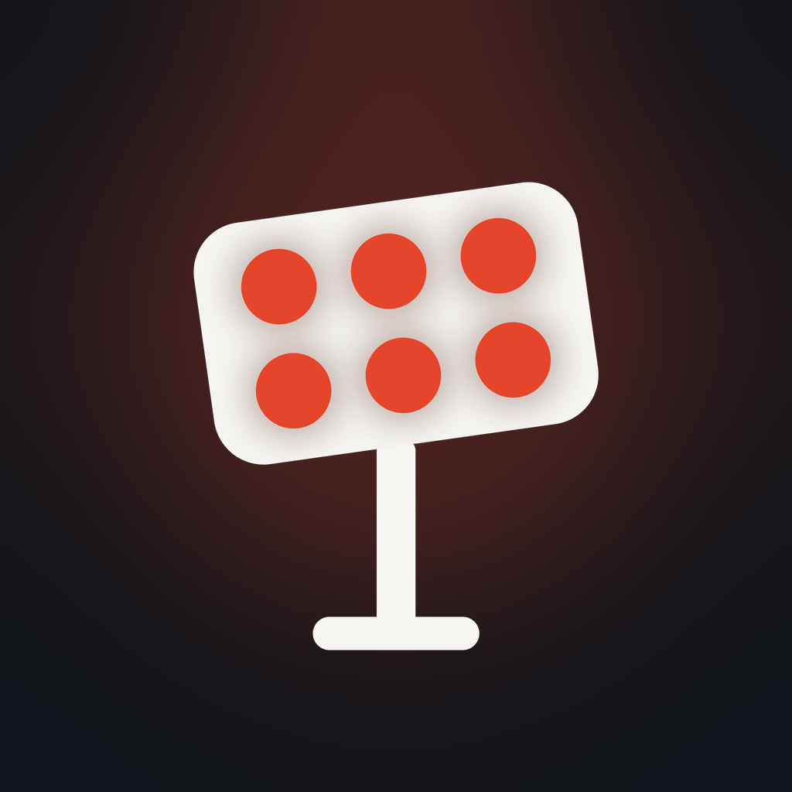</p>

<h1 align="center">Floodlight</h1>
<p align="center">A live scores app template for Flutter. Football, basketball and cricket from one match engine, with every number rolling where it stands the moment it changes.</p>

<p align="center"><b><a href="https://flutterzip.com/#newsletter">Get every new Flutter app by email</a></b> · a new app most days, unsubscribe any time</p>

<p align="center">
  <a href="https://flutterzip.com"></a>
  <a href="https://instagram.com/flutter_zip"></a>
  
  
  
  
  
</p>

<p align="center">
  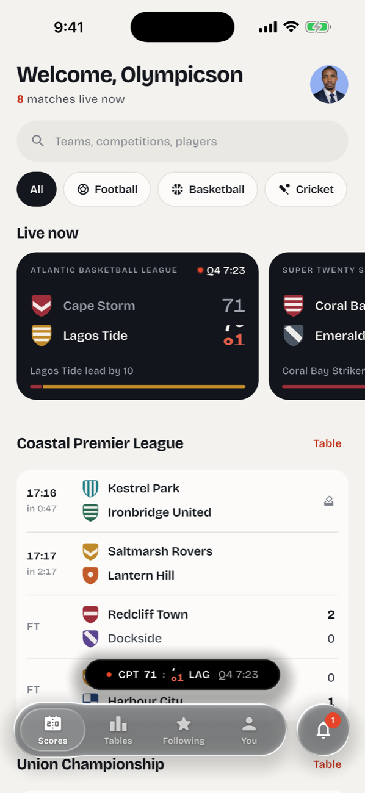
  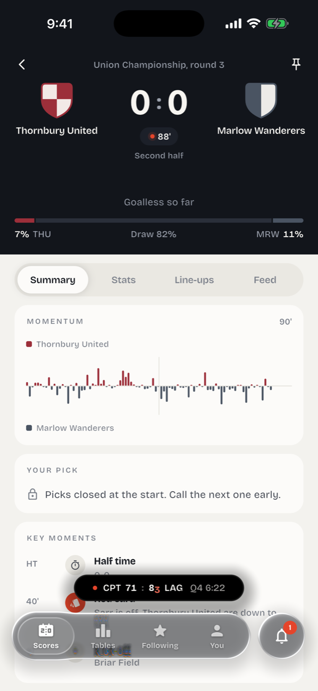
  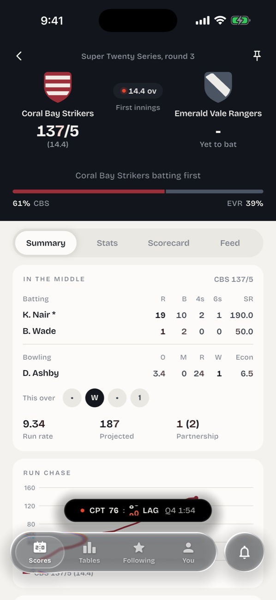
  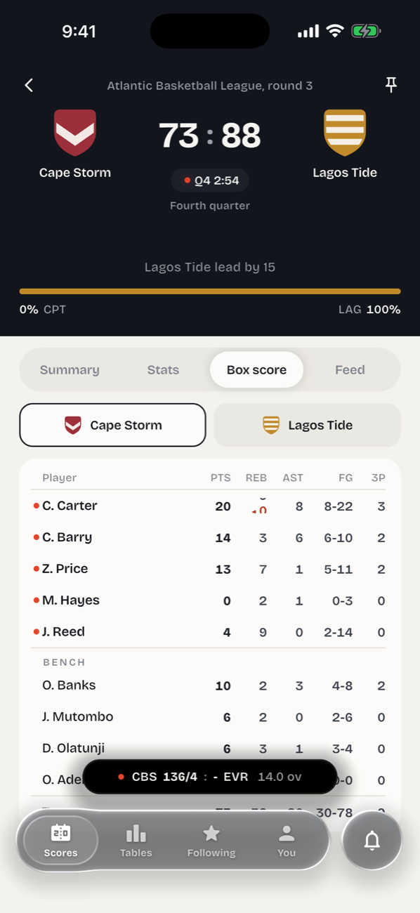
  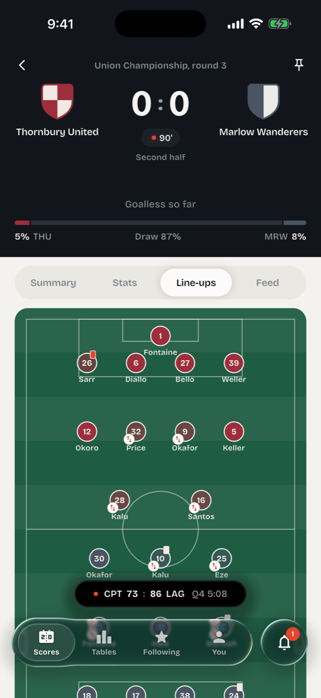
  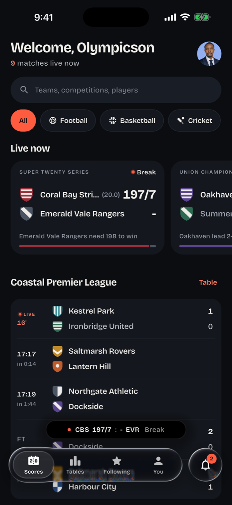
</p>

## Highlights

- **Numbers that roll without anything else moving.** `RollingNumber` is its own render object. Every digit sits in a cell as wide as the widest digit, so `111` and `888` take the same room. A change repaints that one number: no rebuild, no layout. The outgoing and the incoming digit are both drawn and slid one line inside a clip the size of the cell, and columns start a beat apart. It has a baseline, so it lines up beside ordinary text.
- **Three sports, one engine.** Football (goals, cards, substitutions, expected goals, a momentum chart, both elevens on a drawn pitch), basketball (quarters, a lead tracker, a full box score, overtime when it is level) and cricket (ball by ball, the over as it is bowled, batting and bowling cards, fall of wickets, a run-chase chart, required rate).
- **Always something live.** The demo league never stops. A match takes about nine minutes, a round sixteen, and the whole calendar is worked out from the clock, so there is always a match on, one about to start and one just over, whenever the app is opened.
- **Nothing is stored that can be worked out.** A fixture is its id. A match is a pure function of that id and the time, so the same match is the same score in a list row, on its page, in the table and in a test. Tables are added up from results. A pick is right or wrong because of the result, not because something marked it.
- **Listeners are not woken for nothing.** The engine hands back the identical snapshot until something happens in the match, so a page that watches a match does not rebuild between events. A list of fixtures is equal to itself until a match starts or ends.
- **A live pill on every tab.** Pin a match, or follow a team, and the score rides above the tab bar, opens into the scoreboard when tapped, and steps aside on that match's own page.
- **Picks.** Call the winner before the start, change your mind until then, and build a record. Remove one and it blows away as dust, with Undo.
- **Splash to sign out.** Splash, onboarding, sign in and sign up (with Apple and Google), Scores, a match page per sport, Tables, a team page, Following, Picks, Alerts, Search, Profile with an editable photo. Light and dark.
- **A logo that means something.** Six lamps on a mast. On the splash the mast rises, the panel swings up, the lamps come on one at a time, and the light floods out into the first screen. The same lamps flare on the scoreboard when somebody scores.
- **Every colour in one file.** `lib/config/palette.dart` holds the light and dark palettes: chalk paper, night ink and one accent, the red of a live light. A test fails if a colour is written anywhere else. Team crests are drawn in code from a pattern and an index into a short ramp of tints kept in the same file.
- **One switch to a real feed.** Three repositories, all chosen in `lib/providers/core_providers.dart`.

## Screens

| | | | | | |
|---|---|---|---|---|---|
| 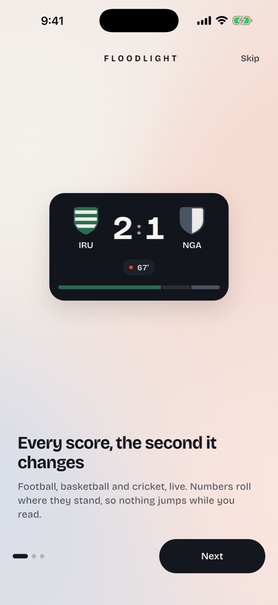 | 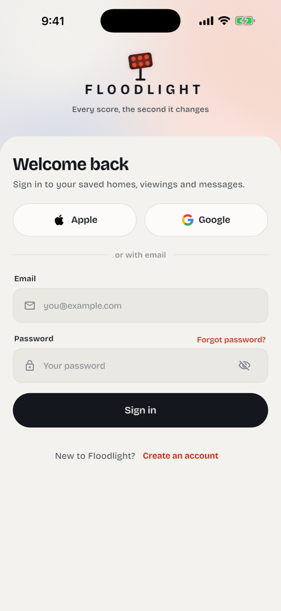 |  |  | 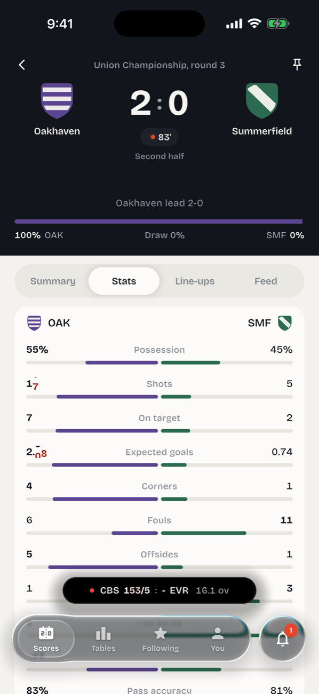 |  |
| 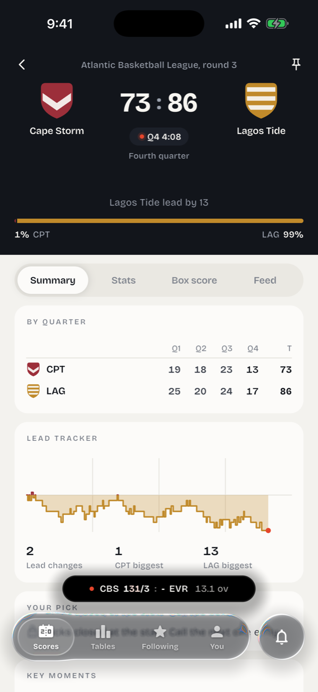 |  |  | 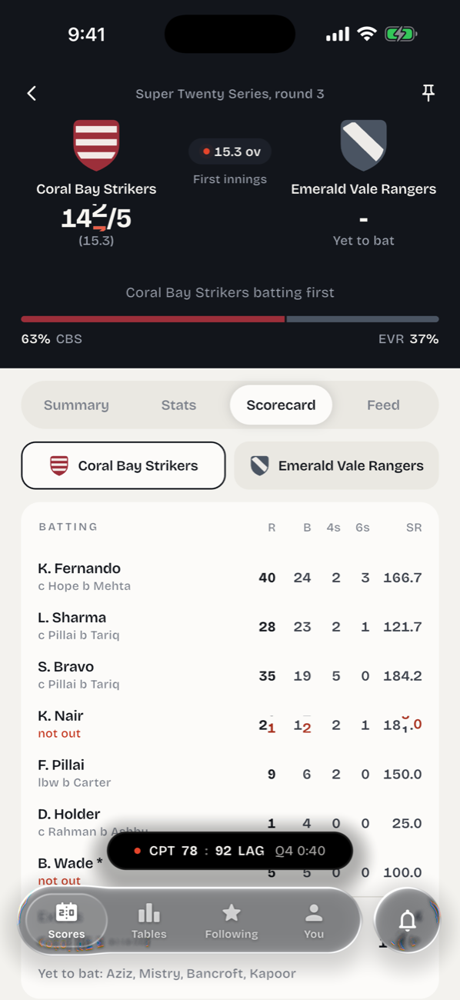 | 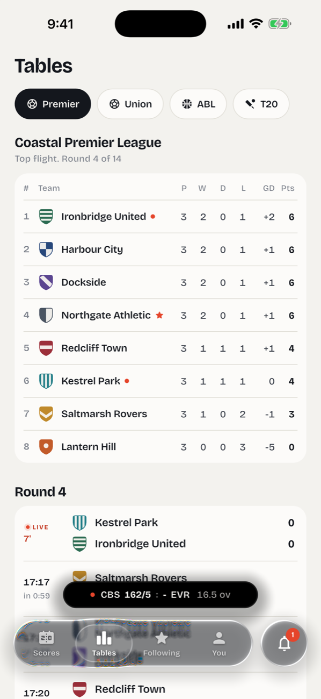 | 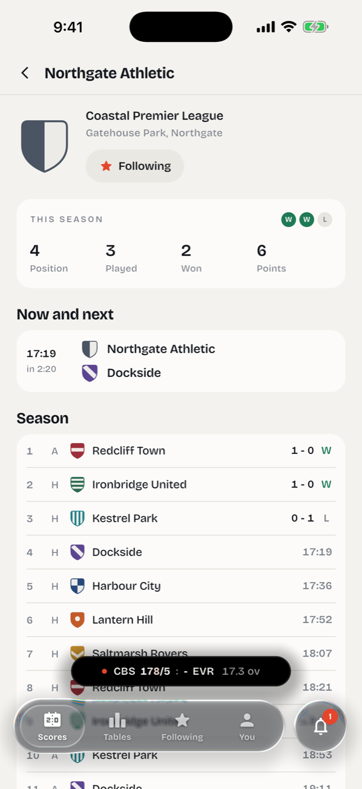 |
| 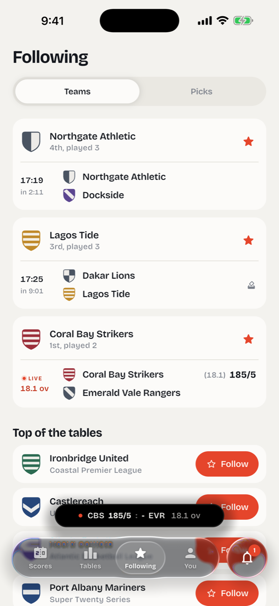 | 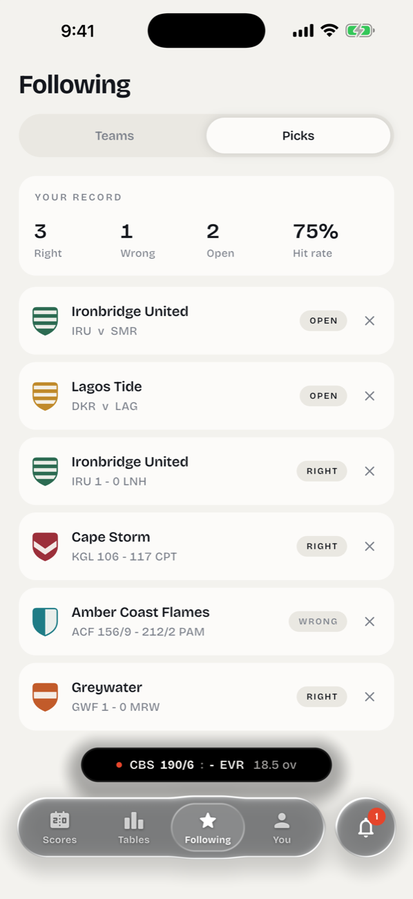 | 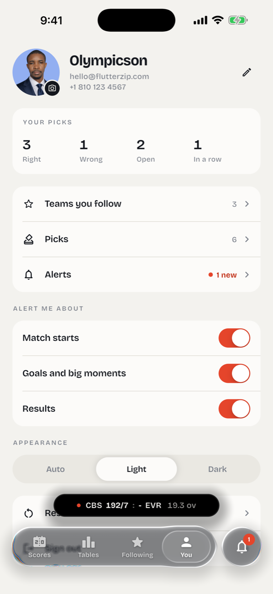 |  | 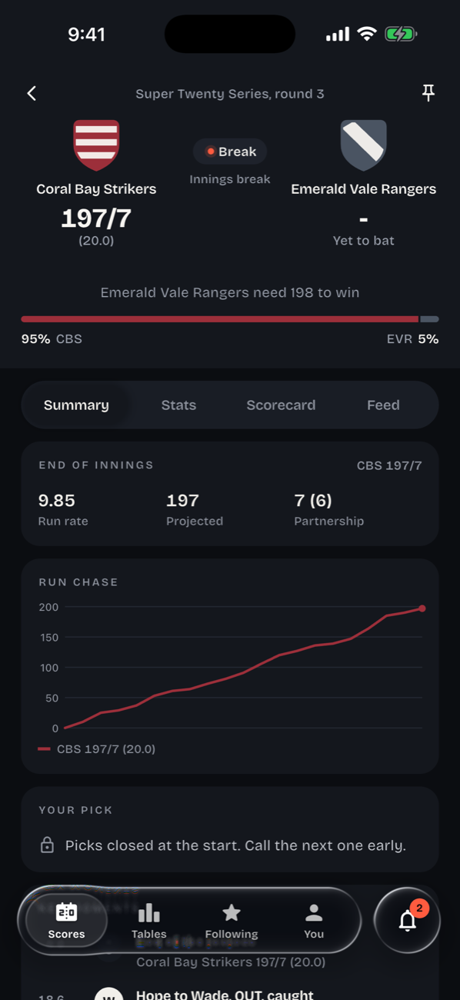 | 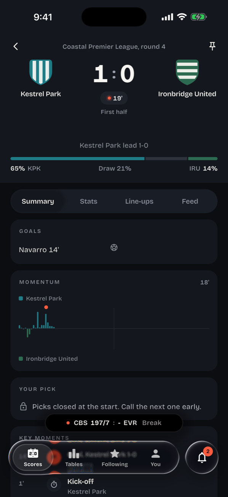 |

## Try the demo

- **Sign in with anything.** Any well-formed email and password signs you in as the demo person. The password `wrongpass` shows the wrong-password state.
- **Watch a number roll.** Open any live basketball game: the score changes every few seconds. In cricket, open a live match and watch the Summary tab: one ball can move ten figures at once and nothing shifts.
- **Wait for a goal.** On a live football match the lamps flare behind the score, the win chance bar slides and the momentum chart gains a dot.
- **Scroll a match.** The scoreboard shuts to a bar under the status bar, with the score still rolling in it.
- **Pin a match.** Tap the pin on a match page, go back, and the score rides above the tab bar on every tab. Tap it to open it, tap again to go to the match.
- **Make a pick.** Open a match that has not started and choose a winner. Your record is in Following, Picks. It opens with three right, one wrong and two still to play.
- **Follow a team.** On a team page or in Following, tap Follow: the crest flies into the Following tab.
- **Filter to one sport.** If nothing in that sport is live for a moment, the screen says so and counts down to the next start.
- **Search.** Try "north", "lagos tide", a player's name, and "zzz" for the empty state.
- **Start again.** Profile, Reset demo data.

## Getting started

```bash
flutter pub get
flutter run
```

Flutter 3.38 or newer. The glass tab bar and the live pill use shaders, which need Impeller, the default on iOS and Android.

## Make it yours

| To change | Edit |
|---|---|
| Every colour, light and dark, and the crest tints | `lib/config/palette.dart` |
| The app icon, from the palette | `python3 tool/make_mark.py && python3 tool/make_icons.py` |
| The name and tagline | `lib/config/app_brand.dart` |
| The logo's shape | `MarkGeometry` in `lib/widgets/floodlight_mark.dart` (and the same numbers in `tool/make_mark.py`) |
| Competitions, teams and players | the tables in `tool/make_seed.py`, then `python3 tool/make_seed.py` |
| The demo person, who they follow, their first picks | `assets/data/profile.json`, `assets/data/demo.json` |
| How fast the demo league plays | `Pace` in `lib/engine/schedule.dart`, and the pace constants at the top of each engine |
| Typeface and type scale | `lib/config/app_theme.dart` |
| How things move, and how long the app waits | `lib/config/motion.dart`, `lib/config/app_timing.dart` |
| Spacing and radii | `lib/config/design_tokens.dart` |
| The launch screen colour | `ios/Runner/Assets.xcassets/LaunchBackground.colorset`, `android/app/src/main/res/values*/colors.xml` |

## Connect a live feed

Every screen reads through a repository, and each one is chosen in `lib/providers/core_providers.dart`. Write the `Remote...` class sketched at the foot of each file and return it there. No widget, provider or model changes.

| Repository | Serves |
|---|---|
| `ScoreRepository` | Competitions, teams, fixtures, live matches, tables |
| `AuthRepository` | Sign in, sign up, Apple and Google, password reset |
| `AccountRepository` | Profile, teams followed, picks, the pinned match, alert choices, recent searches |

`ScoreRepository` answers synchronously on purpose: a live screen asks for the latest state every second, so the repository answers from memory and keeps that memory fresh on its own. In the demo the memory is the match engine. A network implementation fills the same `MatchSnapshot` shapes from its socket and nothing above it changes. Nothing outside `lib/services/` and `lib/engine/` reads the seed or runs the engine (a test enforces it).

Profile photos go through `MediaStore` (`lib/services/media_store.dart`), the place to swap in an uploader.

## Add a sport

1. Add it to `Sport` in `lib/models/league.dart`.
2. Write its snapshot in `lib/models/` (extend `MatchSnapshot`) and its engine in `lib/engine/` (extend `MatchScript`: play the match once into timed steps, then fold the first N steps into a snapshot).
3. Return the engine from `SimulatedScoreRepository._script`, and add its sections to `SummaryTab` and `detailTab` in `lib/screens/match/match_tabs.dart`.

The compiler lists every `switch` that needs the new case.

## Project structure

```
lib/
  config/      palette, theme, brand, motion, timing, tokens, launch hooks
  models/      League, Fixture, MatchSnapshot and one per sport, Pick, StandingRow
  engine/      the schedule, one engine per sport, tables, the win chance maths
  services/    the repositories, the seed, the store, media
  providers/   Riverpod state; core_providers.dart is the data switchboard
  widgets/     RollingNumber, crests, the mark, match rows, the live pill
  screens/     one folder per screen
  kit/         shader and physics components (glass bar, live pill, fly-to, dust)
assets/data/   the demo data, one JSON file per entity
tool/          seed, icon and screenshot scripts
```

## How it is built

Riverpod for state, `shared_preferences` for what the person changes on top of the seed, and one navigator per tab so pages open inside their tab and the glass bar and the live pill stay.

One provider ticks once a second and everything live hangs off it, so the whole app steps forward together. Each engine plays its match once, from a seed taken from the fixture id, into a list of timed steps; a snapshot is the first N steps folded together and is cached until N changes. Scores, statistics, line-up marks and commentary are all added up in that one fold, so they can not disagree.

Animations drive render objects, painters and listenables rather than rebuilding widgets. Charts and crests sit behind repaint boundaries, loops stop when motion is reduced, long lists are lazy, and everything honours reduce motion.

## Testing

```bash
flutter analyze
flutter test
```

150 tests: the engines (determinism, every score adding up, the calendar, tables), `RollingNumber` (no layout while rolling, a fixed box, a baseline), the seed (every state reachable), each screen, the whole app from splash to a pinned match, small phones at large text sizes, and guards on the source (colours only in the palette, the seed read only by repositories, no file over 500 lines).

`tool/run.sh` runs on the simulator with hot reload on a pipe, and `tool/shots.sh` retakes the screenshots above.

## Made by FlutterZip

One Flutter app a day at [flutterzip.com](https://flutterzip.com) and [@flutter_zip](https://instagram.com/flutter_zip). This one was asked for by [Yagnik Barasiya](https://pub.dev/packages/story_dock), who pointed out that a live scorecard is dense data with animated state changes, and harder than it looks.

## Credits

- Every league, club and player is invented. Any likeness to a real one is a coincidence.
- [Bricolage Grotesque](https://github.com/ateliertriay/bricolage) by Mathieu Triay, SIL Open Font License (`assets/fonts/OFL.txt`).
- Material Symbols icons, Apache 2.0.

## License

The code is released under the [MIT License](LICENSE): use it in personal and commercial apps, free.
The Bricolage Grotesque font is under the [SIL Open Font License 1.1](assets/fonts/OFL.txt).
